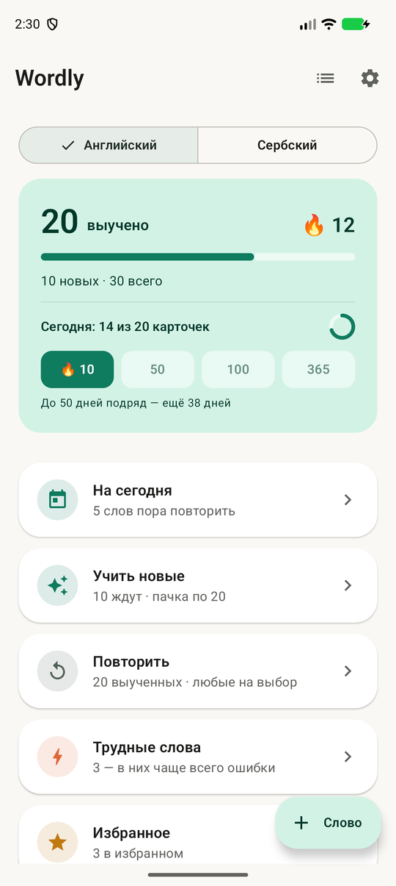
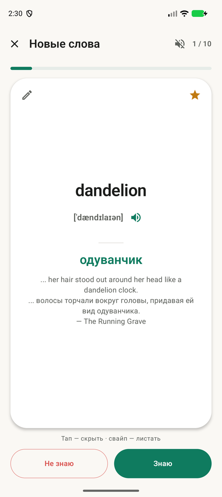
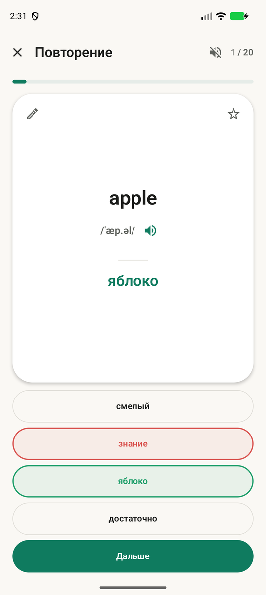
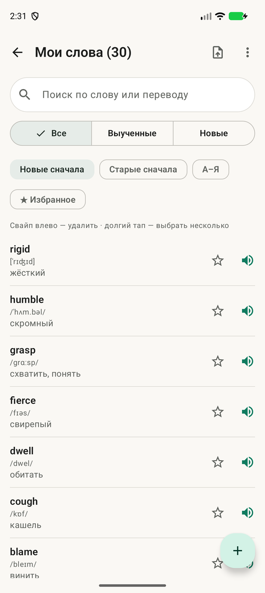
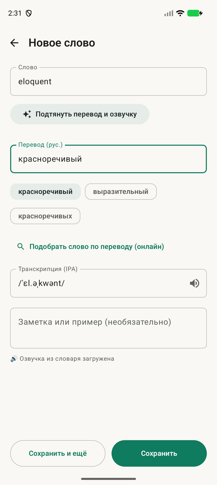

# Wordly

Android-приложение для заучивания иностранных слов с русским переводом — английских и сербских.
Свой словарь, карточки, интервальные повторения, несколько режимов ответа и ежедневное напоминание.

*An Android app for learning English and Serbian vocabulary with Russian translations
(Kotlin, Jetpack Compose). The UI is in Russian.*

<p>
  
  
  
  
  
</p>

## Возможности

**Учёба**
- Новые слова пачками (10 / 20 / 50 / 100), перемешанные или по порядку, с подтверждением,
  какие из них выучены.
- Ответ «Знаю / Не знаю», повтор ошибок, проход тех же слов в обратную сторону (EN→RU ↔ RU→EN).
- Режимы: карточки, ввод с клавиатуры (с допуском опечатки), выбор из 4, на слух.
- Интервальные повторения: «На сегодня» показывает слова, которые пора повторить.
- «Трудные слова» — где ошибок больше, чем верных ответов. Избранное.
- Свайпы по карточке, автоозвучка, правка слова прямо во время сессии.

**Словарь**
- Перевод, транскрипция и озвучка подтягиваются по кнопке; для сербского — перевод и ударение
  (например, *hvála*), латиницей или кириллицей.
- Поиск оригинала по переводу, проверка дубликатов, заметки и примеры.
- Импорт из CSV, Google Таблиц и файлов Anki (.apkg), включая выгрузку словаря из 2Books;
  экспорт в CSV.

**Мотивация**
- Серия дней подряд, цель на день, вехи 10 / 50 / 100 / 365 дней.
- Ежедневное напоминание (по умолчанию в 12:00) с текущей серией.

## Сборка

Нужны JDK 17+ и Android SDK (подойдут те, что идут с Android Studio).

```bash
./gradlew :app:assembleDebug        # APK: app/build/outputs/apk/debug/
./gradlew :app:installDebug         # установить на подключённое устройство
./gradlew :app:testDebugUnitTest    # юнит-тесты
```

`minSdk 26`, `targetSdk 35`. Kotlin, Jetpack Compose, Room, WorkManager, Retrofit, ML Kit.
Устройство кода описано в [CLAUDE.md](CLAUDE.md).

## Источники данных

- **[FreeDict](https://freedict.org/)** — офлайн-словарь английский → русский
  (`app/src/main/assets/freedict_eng_rus.db`), собран из `eng-rus.tei` скриптом
  `scripts/build_freedict_db.py`. Данные FreeDict (на основе WikDict / DBnary / Викисловаря)
  распространяются по лицензии
  [CC BY-SA 3.0](https://creativecommons.org/licenses/by-sa/3.0/); этот файл подпадает под неё же,
  а не под лицензию кода.
- **[Wiktionary](https://www.wiktionary.org/)** (английский и русский) — транскрипция, озвучка,
  переводы и ударения запрашиваются во время работы приложения через MediaWiki API
  (тексты — [CC BY-SA](https://creativecommons.org/licenses/by-sa/4.0/)). Сохранённые фрагменты
  страниц в `app/src/test/resources/wiktionary/` используются только в тестах.
- **[Free Dictionary API](https://dictionaryapi.dev/)** — транскрипция и озвучка (запасной источник).
- **[Google ML Kit Translation](https://developers.google.com/ml-kit/language/translation)** —
  перевод на устройстве.

## Лицензия

Код — [MIT](LICENSE). Офлайн-словарь FreeDict — CC BY-SA 3.0 (см. выше).
